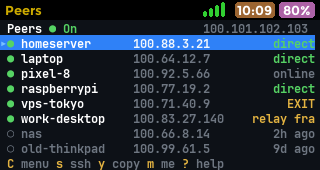
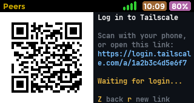

# Peers for Tailscale

An unofficial Tailscale client for the [CardputerZero](https://docs.m5stack.com/en/CardputerZero)
launcher. It runs in the launcher's built-in terminal.

 

- **Log in with your phone:** if the Cardputer is not logged in, press Enter and scan the QR code
  on its screen. You can also log out (`m`, then `o`).
- **Devices:** lists every device on your tailnet with its IP and how you reach it (direct,
  DERP relay, or when it was last seen). Press `/` to filter.
- **Per device:** SSH in the same terminal, copy the IP/DNS name (read it back with `ts-clip`),
  `tailscale ping`, details, a shell with `$IP` set, use as exit node.
- **This Cardputer:** IPs, account, key expiry, connect/disconnect, exit node, LAN access.
- No Tailscale yet? Press Enter to install it with the official script.

## Install

From the CardputerZero app store, or build the package on the device:

```sh
sudo bash install.sh        # builds build/cz-peers_<version>_all.deb and installs it
```

The package was called `cz-tailscale` up to 1.1.0; installing `cz-peers` replaces it and keeps the saved SSH users.

The package makes the desktop user Tailscale's operator (`tailscale set --operator`), so the app
can change settings without sudo.

## How the QR code is shown

The terminal's cells are 7x15 px, too coarse for a QR code. The login view fills the left part of
the terminal with white cells, and the app draws the code on top of them in `/dev/fb0`. The
launcher only repaints cells whose content changes, so the code stays on screen. `app/qr.py` is a
small built-in QR encoder, so the package has no extra dependencies.

## Development

- `tools/fake_tailscaled.py` serves a fake LocalAPI with placeholder devices. Run the app with
  `CZ_TS_SOCKET=<socket>` to try logging in and out without touching the real tailscaled.
- `tools/drive.py` runs the app in a 45x10 pty and types keys. `tools/show.py` prints the screens.
- `tools/screenshot.py` renders a recording the way the launcher's terminal draws it (its 16-colour
  palette, fonts and cell size). The store screenshots were made this way from the fake daemon.
- `tools/qr_check.py` decodes what `app/qr.py` encodes and checks it.

## License

MIT. Unofficial app, not affiliated with or endorsed by Tailscale Inc. Tailscale is a registered
trademark of Tailscale Inc.
